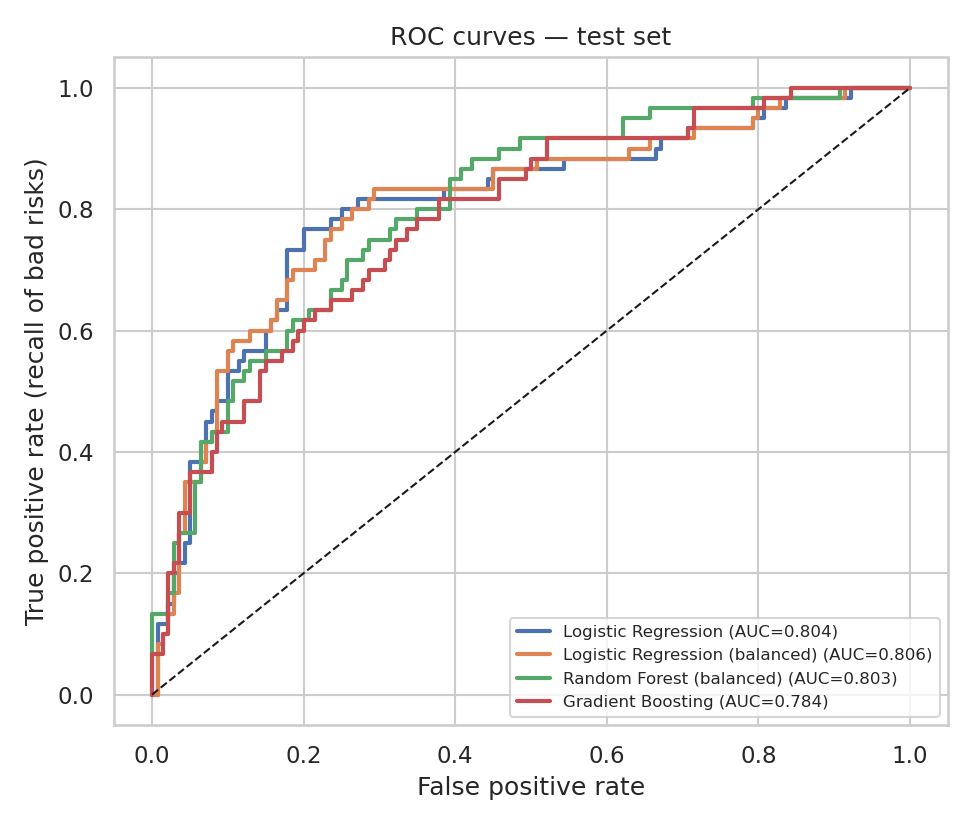
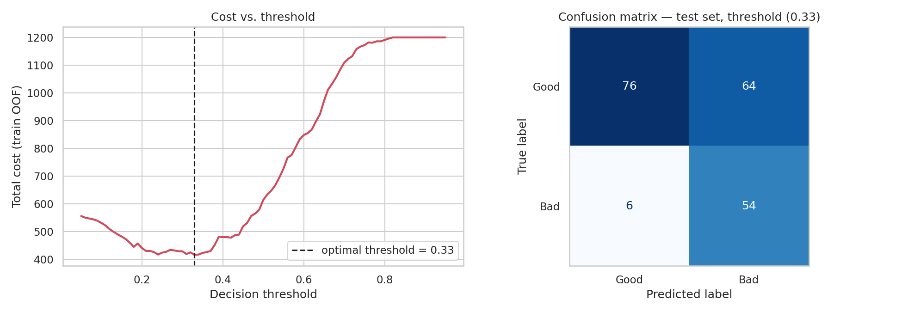

# Credit Risk Scoring — German Credit Dataset

🇬🇧 English · 🇫🇷 [Version française](README_fr.md)

Predicting loan default on the UCI **German Credit** dataset (1,000 applicants, 20 features) and choosing a decision threshold that minimises the **business cost** of errors (approving a defaulter costs 5× more than rejecting a good client).

## Highlights
- Clean, leakage-free **scikit-learn Pipeline** (stratified split, scaling + one-hot inside CV).
- 4 models compared with **5-fold stratified CV**: Logistic Regression (± class weights), Random Forest, Gradient Boosting.
- Metrics suited to imbalance (30 % bad risks): **ROC-AUC, PR-AUC, recall of bad risks**, not just accuracy.
- **Cost-sensitive threshold** chosen on out-of-fold predictions (no test leakage).
- **Interpretability:** logistic-regression odds ratios + permutation importance.

## Key results (hold-out test set, 200 applicants)
| Strategy | Total cost (FN×5 + FP×1) | Recall of bad risks |
|---|---|---|
| Approve everybody | 300 | 0.00 |
| Reject everybody | 140 | 1.00 |
| Random Forest @ threshold 0.50 | 150 | 0.58 |
| **Random Forest @ optimised threshold 0.33** | **94** | **0.90** |

Cost drops by **37%** (150 → 94) at the price of rejecting ~46% of good clients. ROC-AUC ≈ 0.77–0.81 for all models (differences are within CV noise); exact figures vary slightly with library versions. The checking-account status is by far the strongest predictor.




## Project structure
```
├── data/german.data              # raw UCI file (no header)
├── notebooks/
│   ├── credit_risk_en.ipynb      # full analysis (English)
│   └── credit_risk_fr.ipynb      # full analysis (French)
├── images/                       # figures exported by the notebooks
├── requirements.txt
└── README.md / README_fr.md
```

## Run it
```bash
pip install -r requirements.txt
jupyter notebook notebooks/credit_risk_en.ipynb
```

## Limitations
Small dataset (1994, Germany): test metrics are noisy. `personal_status`, `foreign_worker` and `age` are sensitive attributes that a real scoring model could not use; they are kept here only to match the original benchmark. See the notebook's conclusion for next steps (calibration, SHAP, fairness audit, Streamlit demo).

## Data source
Hofmann, H. (1994). *Statlog (German Credit Data)*. UCI Machine Learning Repository.

## Author
**RAHHAL Fatima Zahrae** — [GitHub](https://github.com/rahhalfatimazahrae) · [LinkedIn](https://www.linkedin.com/in/fatima-zahrae-rahhal-88b459300/)
