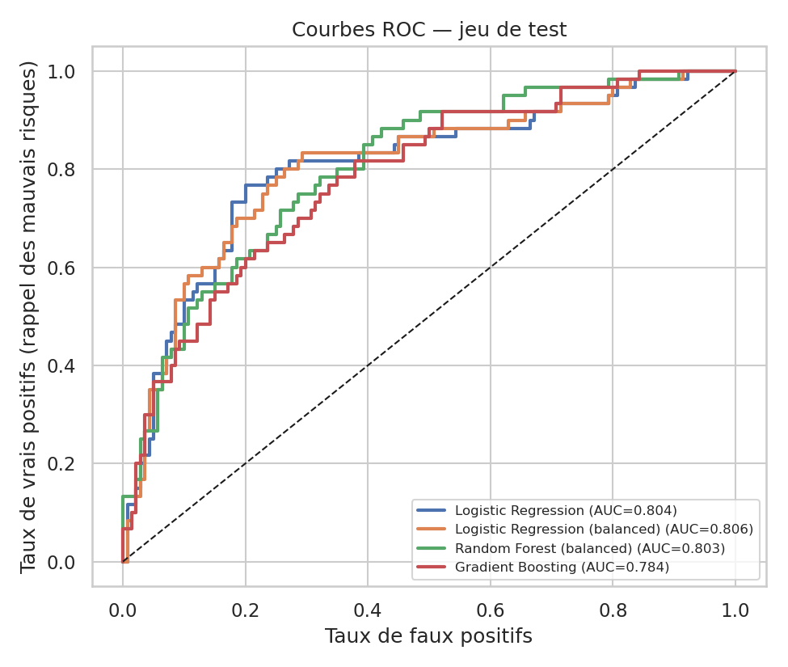
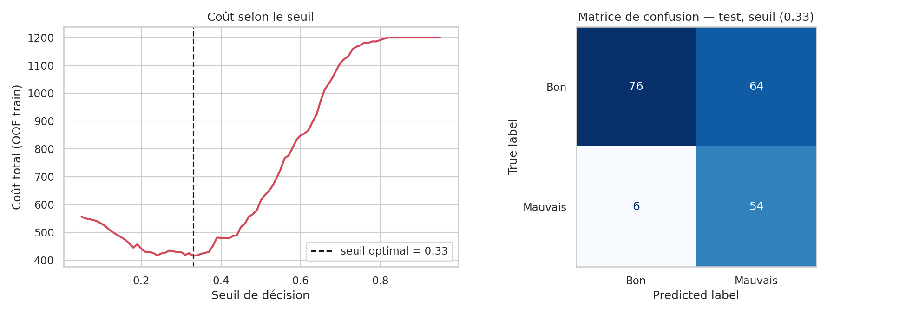

# Scoring du risque de crédit — German Credit Dataset

🇫🇷 Français · 🇬🇧 [English version](README.md)

Prédiction du défaut de remboursement sur le jeu de données UCI **German Credit** (1 000 demandeurs, 20 variables) et choix d'un seuil de décision qui minimise le **coût métier** des erreurs (accepter un défaillant coûte 5 fois plus cher que refuser un bon client).

## Points clés
- **Pipeline scikit-learn** propre et sans fuite de données (découpage stratifié, standardisation + one-hot dans la CV).
- 4 modèles comparés en **validation croisée stratifiée à 5 plis** : Régression logistique (± pondération des classes), Random Forest, Gradient Boosting.
- Métriques adaptées au déséquilibre (30 % de mauvais risques) : **ROC-AUC, PR-AUC, rappel des mauvais risques**, et pas seulement l'accuracy.
- **Seuil sensible au coût** choisi sur des prédictions out-of-fold (aucune fuite du test).
- **Interprétabilité :** odds ratios de la régression logistique + importance par permutation.

## Résultats principaux (jeu de test, 200 demandeurs)
| Stratégie | Coût total (FN×5 + FP×1) | Rappel des mauvais risques |
|---|---|---|
| Tout accepter | 300 | 0,00 |
| Tout refuser | 140 | 1,00 |
| Random Forest @ seuil 0,50 | 150 | 0,58 |
| **Random Forest @ seuil optimisé 0,33** | **94** | **0,90** |

Le coût baisse de **37 %** (150 → 94) au prix du refus d'environ 46 % des bons clients. ROC-AUC ≈ 0,77–0,81 pour tous les modèles (écarts dans le bruit de la CV) ; les chiffres exacts varient légèrement selon les versions de bibliothèques. Le statut du compte courant est de loin le prédicteur le plus fort.




## Structure du projet
```
├── data/german.data              # fichier brut UCI (sans en-tête)
├── notebooks/
│   ├── credit_risk_en.ipynb      # analyse complète (anglais)
│   └── credit_risk_fr.ipynb      # analyse complète (français)
├── images/                       # figures exportées par les notebooks
├── requirements.txt
└── README.md / README_fr.md
```

## Exécution
```bash
pip install -r requirements.txt
jupyter notebook notebooks/credit_risk_fr.ipynb
```

## Limites
Petit jeu de données (1994, Allemagne) : les métriques de test sont bruitées. `personal_status`, `foreign_worker` et `age` sont des attributs sensibles qu'un vrai modèle de scoring ne pourrait pas utiliser ; ils sont conservés ici uniquement pour coller au benchmark d'origine. Voir la conclusion du notebook pour les pistes (calibration, SHAP, audit d'équité, démo Streamlit).

## Source des données
Hofmann, H. (1994). *Statlog (German Credit Data)*. UCI Machine Learning Repository.

## Auteur
**RAHHAL Fatima Zahrae** — [GitHub](https://github.com/rahhalfatimazahrae) · [LinkedIn](https://www.linkedin.com/in/fatima-zahrae-rahhal-88b459300/)
